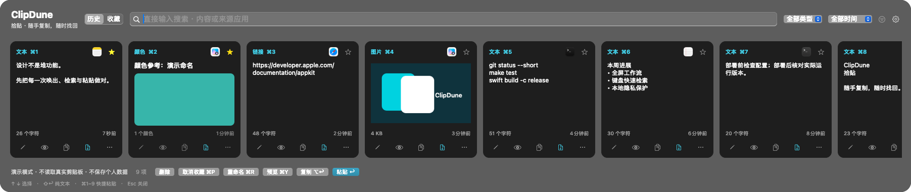
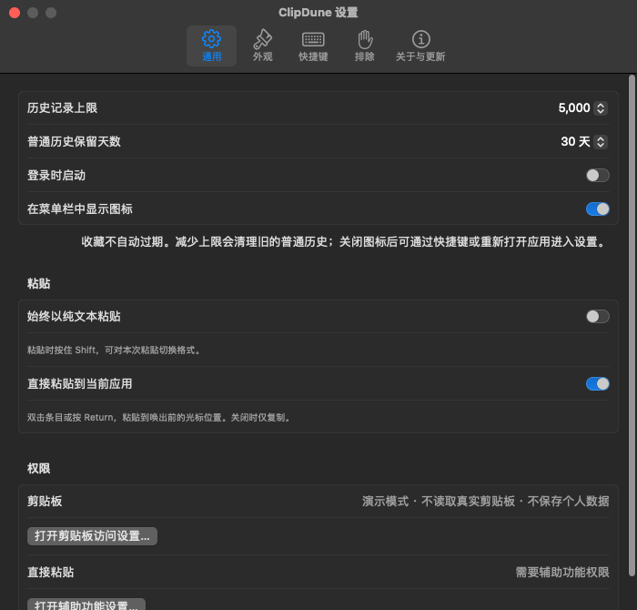

# ClipDune · 拾贴

随手复制，随时找回。一个独立实现、以键盘工作流为先的 macOS 剪贴板工具。

当前为 **0.3.1 开发预览版**。自用优先，未来是否付费发行另行决定；尚未公证、未提交 Mac App Store，不应当作正式发行包。

本机验证结果与版本边界见 `docs/verification.md`。Release 应用包的普通／原生全屏交互与设置窗口有隔离检查；真实终端授权后的直接插入、完整升级后重启与公证仍需分别验收。





## 开始使用

要求 macOS 14+、Swift 6 工具链。没有第三方包依赖，系统 SQLite 提供存储与索引。

```bash
make test       # 隔离数据与剪贴板测试，不需要 XCTest
make build      # dist/ClipDune.app，当前机器架构的开发签名包
make demo       # 合成演示内容，不读取系统剪贴板
make run        # 实际使用，按需授权后台读取与直接粘贴
make release    # 优化构建，不代表正式发行或公证
```

正常使用：将 `dist/ClipDune.app` 放入 Applications 并打开；开发入口也可运行 `make run`。首次使用在菜单或设置中允许后台读取，应用会打开对应系统设置页。直接粘贴另需辅助功能权限；没有权限仍可复制选中项，再手动按 `⌘V`。登录启动和在线安装需要完整应用包。

## 当前能力

- 底部原生卡片面板，跟随显示器可见宽度，左右只留 16 pt；打开后直接输入搜索，无需先点击输入框。
- 每次重新打开恢复默认历史，并滚回最左端的最新项；底部“回到最新”按钮可在浏览中一键返回当前结果开头，保留搜索与筛选。
- 点击卡片让搜索框失焦后，继续打字也会自动聚焦并搜索；双击正文、图片或卡片空白位置均可执行粘贴。
- 原生全屏空间与普通窗口使用同一唤出／焦点路径，具体已验证范围见 `docs/verification.md`。
- 区分文本、富文本、HTML、图片、链接、文件、颜色和其他数据；保留已捕获的原始表示，不将所有内容降成纯文本。
- 每张卡片提供收藏、重命名、预览、复制、粘贴按钮及更多／右键菜单；图标有中文悬停提示。
- 显示来源应用图标与大小信息：文本显示字符数，图片显示首选图像数据量，文件显示引用数量，不误报文件实际大小。
- 内容、来源应用名和自定义名称均可搜索；名称不改变实际粘贴内容，历史和收藏共享名称，重复复制仍保留。
- 顶部类型与时间筛选可组合关键词、历史／收藏使用，支持今天、昨天、最近 7 天／30 天与全部时间，筛选状态可见并可一键清除。
- 收藏、删除、只读预览、单次格式切换、暂停、应用排除、离线备份导入导出。详细规则见 `docs/content-and-search.md`。
- 全局快捷键可切换；快捷键被占用时显示状态，不静默失效。
- 直接粘贴前核对原应用及其可访问性焦点；不自动切换到另一个目标窗口。
- 原生设置窗口：通用、外观、快捷键、排除、关于与更新。历史上限、保留天数、纯文本默认、直接粘贴、主题与卡片密度立即生效。
- 权限按钮自动打开剪贴板／辅助功能对应系统设置页；授权开关仍由用户手动确认。
- 私有 GitHub Release 在线升级：钥匙串授权、可取消下载、Ed25519 清单与安装包校验、安装确认、原子替换、重启失败回滚。详见 `docs/updates.md`。

| 操作 | 默认按键 |
| --- | --- |
| 唤出／关闭 | `⌘⇧V`，菜单可换成 `⌃⌥Space` 或 `⌃⇧V` |
| 搜索 | 唤出后直接输入，`⌘F` 回到搜索框 |
| 选择条目 | `↑` / `↓`，左右键保留给文本编辑 |
| 粘贴／纯文本粘贴 | `Return` / `Shift-Return` |
| 仅复制 | `Option-Return` |
| 快捷粘贴 | `⌘1`–`⌘9` |
| 收藏／预览 | `⌘P` / `⌘Y` |
| 重命名 | `⌘R` 或卡片铅笔按钮，历史与收藏共享名称 |
| 回到最新 | 点击底部“回到最新”，保留当前关键词、类型、时间与收藏条件 |
| 设置 | `⌘,` 或面板右上角齿轮 |
| 关闭 | `Esc`；输入法正在组词时优先交给输入法 |

直接粘贴的成功提示仅代表已发送按键，不代表目标应用已经接受或插入内容。无法核对目标、没有权限或用户切换目标时，仅复制，并提示手动粘贴。

## 数据与隐私

- 正常模式数据位于 `~/Library/Application Support/ClipDune/history.sqlite3`，目录权限 `0700`、数据库 `0600`。
- 剪贴板内容不上传；没有遥测、云同步、AI 或 MCP，也不把正文写入日志。联网仅用于已启用的 GitHub 版本更新。
- 普通历史默认最多 5,000 项、保留 30 天，设置可调整；按最近使用时间排序和清理，收藏不按条数或时间自动删除。再次复制和在应用内复制／粘贴会前移原条目，不新增同内容同格式的副本。
- 所有条目的序列化内容与缩略图共享逻辑预算，默认 256 MiB，可在设置中选择 64、128、256、512 MiB、1 或 2 GiB；单项原始内容仍最多 16 MiB。该预算不是数据库、WAL、索引和备份文件的实际磁盘总量上限。
- 降低容量前确认；超限优先删除最久未使用的非收藏项。收藏计入容量但不自动删除；无法容纳新内容时拒绝新增，降低上限无法容纳收藏时保留原设置与历史。
- 本地数据库及 `.clipdunebackup` 备份**没有应用层加密**；备份可能包含敏感内容，只应保存到可信位置。
- 根据来源应用与剪贴板敏感标记排除内容。**不能自动识别所有密码、令牌或个人信息**，尤其是未标记的浏览器扩展内容。
- 应用排除只阻止未来采集；旧历史需要删除。备份导入也执行当前排除与敏感标记策略。
- 完整备份文件仍有独立的 384 MiB 安全上限，导入最多 20,000 项；提高历史容量不会扩大备份上限，超大导出明确拒绝。导入仍受普通历史的保留策略和存储预算约束。
- 文件项保存引用，不复制文件内容；原文件移动、删除或无权限后引用可能不可用。
- 自定义“其他”数据只保存和回填原始字节，不执行或联网加载；能否被目标应用识别取决于该应用。
- 名称、类型、来源与大小存放在附表，既有历史自动回填；主表和旧版可读取载荷保持兼容，不清空历史。
- 清理历史不修改系统剪贴板；不承诺操作系统备份、已导出文件或介质上的安全擦除。
- 演示与测试使用临时数据库、独立命名剪贴板，不读取正常历史。

## 工程与测试

```text
Sources/ClipDuneCore     内容模型、策略、事务存储、检索与备份
Sources/ClipDuneMac      macOS 捕获、热键、焦点、面板与粘贴
Sources/ClipDuneApp      菜单、生命周期、权限入口、演示与 QA
Sources/ClipDuneQAHost   独立的普通／全屏输入测试宿主
Sources/ClipDuneUpdateHelper  非提权更新安装与重启确认
Sources/ClipDuneReleaseTool   仓库外私钥管理、清单签名与真实下载验证
Tests/ClipDuneTests      不依赖 XCTest / Testing 宏插件的自包含测试
docs/                   设计、验证范围与问题复盘
```

`make ui-check` 使用 SwiftPM 开发入口，暂时打开自己的普通／原生全屏测试窗口，测试唤出即输入、中文输入状态、连续唤出与焦点归还。`bash scripts/check-ui.sh bundle` 单独验证打包入口。不会操作真实终端，不执行命令，不读取系统剪贴板。屏幕锁定或启动受限时明确失败／阻塞，不把它算作通过。

当前工具链只有 Command Line Tools，缺少 XCTest，且内置 Testing.framework 缺少 TestingMacros 插件，因此默认测试入口是 `make test`，不是 `swift test`。

## 后续边界

尚未实现：自定义收藏分组、OCR、顺序粘贴、云同步、AI、Windows、付费购买、App Sandbox 发行配置、签名公证与商店审核。先验证日常全屏与输入体验，再根据实际反馈扩展。

0.1.0 没有更新器，首次需要手动安装当前版本；0.2.0 及之后版本可直接检查新版更新。在“设置 → 关于与更新”配置自己的仓库只读令牌。自动检查不代表自动安装，下载和安装均由用户确认。

产品研究参考 Paste 与 Clipbara 的公开功能和交互；本工程没有复制 Clipbara 源码、资产或 Git 历史，也没有依赖其包。前期研究曾阅读其实现，不声称经过法律意义上的洁净室流程。名称只做了初步公开检索，尚未完成商标审查。
