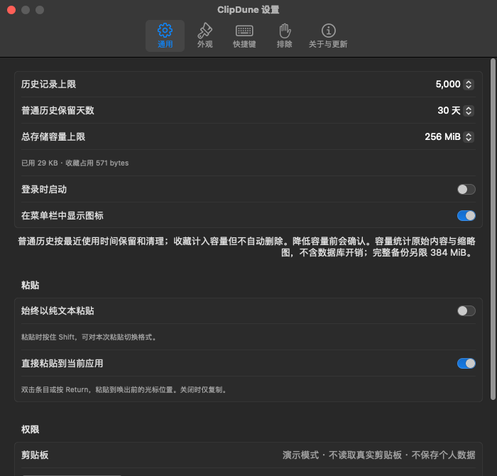

# 卡片操作、内容类型与搜索

适用版本：0.3.1，2026-10-22。

## 不依赖快捷键的操作

卡片右上角的星形按钮直接收藏／取消收藏；底部提供重命名、预览、仅复制、粘贴和更多按钮。按钮始终可见，每个按钮都有中文悬停提示和辅助功能标签。菜单栏底部的已有操作与快捷键仍保留。

右键卡片或点击更多可执行同一组操作，并提供单次格式切换和删除。删除与常用按钮分开，避免紧凑布局下误触。所有回调按内容 ID 重新查找条目，不能把当前点击的按钮应用到旧选中项。

双击正文仍按原有逻辑直接粘贴；按钮点击被排除在正文双击命中范围之外。重复双击按钮不会额外触发正文粘贴。

每次重新唤出面板都会清空搜索与筛选、回到默认历史最左端并选中最新项。浏览过程中可点击底部“回到最新”按钮：只返回**当前结果**最左端并选择第一项，保留关键词、类型、时间及历史／收藏状态，不复制或粘贴内容。返回后仍可直接输入搜索；空结果时按钮禁用。

## 来源与大小

| 字段 | 显示规则 |
| --- | --- |
| 来源图标 | 由保存的应用 Bundle ID 查找本机已安装应用图标；找不到时显示通用图标，悬停仍显示原应用名 |
| 文本、富文本、HTML、链接 | 原文字摘要的 Swift String 字符数，即扩展字素簇；不按 UTF-8 字节数计数 |
| 图片 | 每个片段优先 PNG，再 TIFF/JPEG/GIF/HEIC，合计首选图像表示大小；不叠加同图的备用表示或缩略图 |
| 文件 | 实际 file URL 片段的引用数量；不查询文件磁盘大小，不读取引用内容 |
| 颜色 | 颜色项数量，卡片展示可解析的色值和色块 |
| 其他 | 捕获的原始表示字节总量，预览列出类型名，不执行或加载它们 |

## 支持的内容类型

1. 文本：系统普通文本。
2. 富文本：RTF，保留原始 RTF 与其他可用表示。
3. HTML：没有 RTF 表示的 HTML；独立列出，保留原始 HTML。
4. 图片：PNG、TIFF、JPEG、GIF、HEIC 以及系统识别为图片的其他合法格式。
5. 链接：HTTP(S) URL。
6. 文件：一个或多个文件 URL。
7. 颜色：系统 NSColor 表示或独立的 `#RGB`、`#RRGGBB`、`#RRGGBBAA` 文本。原文本格式不改变；不把普通数字验证码当颜色。
8. 其他：合法类型标识符的原始字节，例如 PDF 或应用自定义数据。按需写回剪贴板，但目标应用是否支持取决于该应用。

保留隐私标记、应用排除、单项 16 MiB、最多 100 个片段与每片段 32 个表示的边界。系统剪贴板控制标记和 file promise 等不能直接持久化的类型不纳入“其他”。

不使用 WebView 渲染 HTML。摘要移除标签以及 script/style 内容，处理常用实体；它不是完整浏览器排版或 HTML 标准转换器，原始 HTML 仍用于保真粘贴。

单项富文本、HTML、链接或颜色在没有原始纯文本表示时，会额外提供文字后备表示，方便粘贴到只接受文本的应用；原始格式仍保留。名称不参与这个后备表示。

## 组合筛选

“全部类型”和“全部时间”始终显示在搜索框右侧。选择后，关键词、类型、时间、历史／收藏条件取交集。清除筛选按钮只重置类型和时间，保留搜索关键词；每次重新唤出恢复默认的全部历史。

时间依据条目的最近使用时间，按当前系统时区计算自然日，采用包含起点、不包含终点的区间。最近 7 天包含今天和前 6 个自然日，最近 30 天同理；不是固定按秒数计算，因此跨夏令时不会多算或少算一小时。

## 去重与最近使用

- 全部片段的内容、类型和数据相同才合并。同一片段内格式排列顺序不影响去重，多个片段之间的顺序仍保留；来源应用、名称与收藏状态不参与指纹。
- 文字相同但富文本、HTML、图像或其他保存格式不同，继续保留不同条目，不用预览文字强行去重。
- 重新采集同内容，或通过 ClipDune 成功写入剪贴板后，原条目移到最前；保留名称、收藏和全部原始格式。纯文本粘贴只改变本次输出，不把原富文本历史改成纯文本。
- 直接粘贴发送成功后再次更新使用时间；若权限或目标检查失败但内容已经复制，也算一次成功复制。写入前取消、写入失败、预览、改名、收藏、浏览均不更新使用时间。
- 不额外监听其他应用中的手动 `⌘V`。发送粘贴指令不等于确认目标应用已经插入内容。
- 卡片显示最近使用的相对时间，悬停可同时查看最近使用与最近采集时间。最近采集时间独立保留，不被应用内粘贴改写。

## 容量与清理

设置 → 通用提供 64、128、256、512 MiB、1、2 GiB 六档，默认 256 MiB，同时显示已用容量与收藏占用。设置成功后立即生效并持久化；降低容量前弹窗确认，取消不会清理数据。

容量、条数与保留天数均按最近使用时间清理非收藏历史。收藏计入容量但不参与自动删除；若新容量连收藏也放不下，事务回滚并保留原设置和全部历史。无法容纳新的复制内容时不记录该项，并在状态中提示清理收藏或提高容量；仍能复制／粘贴已有条目。

容量统计序列化内容与额外缩略图，不等同于数据库、索引、WAL 或备份文件的实际磁盘体积。单项原始内容仍限 16 MiB，完整备份另限 384 MiB、导入最多 20,000 项，不随历史容量放大。导入先完整校验再事务合并，按同一最近使用规则清理超限普通历史；收藏导致预算不足时整个导入回滚。

## 重命名

- 从卡片铅笔按钮、右键菜单、底部按钮或 `⌘R` 进入原生重命名对话框。
- 名称最多 120 个字符，不允许换行与控制字符。首尾空白会去除；空名称恢复默认内容显示。
- 名称仅作管理元数据，不参与内容指纹，也不修改内容、复制时间或粘贴数据。
- 历史和收藏指向同一条记录，因此共享名称；再次复制同一内容保留名称与收藏状态。
- 数据库名称与搜索索引在同一事务中变更，旧名称及时从检索中移除。搜索匹配内容、来源应用名与名称。
- 新备份携带可选名称；没有名称字段的旧备份仍可导入，且不会清空已有条目的名称。

## 数据兼容

保留 `clips` 原有 11 列，避免旧版本 `INSERT INTO clips VALUES(...)` 在回滚时因列数变化失败。新建 `clip_details` 附表保存名称、精确类型、来源 Bundle ID 和大小信息，并为旧记录分批回填。删除主记录同时删除附表记录，避免孤儿名称。

`clip_activity` 独立保存 `last_used_at`，旧记录用 `copied_at` 回填。主表的插入、复制时间更新和删除触发器同步活动记录，继续兼容旧版主表写入；主 schema 版本不变。备份用可选 `lastUsedAt` 保存最近使用时间，旧备份缺省为复制时间；导入旧备份不会把已有条目的最近使用时间倒退。

载荷保留旧版本能解码的 `kind`，增加可选 `contentKind` 存放新类型；新版本优先读取新字段。旧 HTML 数据可由表示集合恢复独立分类。主 schema 版本仍为 1，旧版本可以读取载荷与插入主表，但不会提供新名称／筛选界面。

测试覆盖普通历史、收藏、重复复制、重新打开数据库、名称更改与清空、名称检索、备份往返、旧归档导入、旧主表写入语句及新类型旧载荷读取。测试仅使用临时目录和命名剪贴板，不读取用户真实历史。
